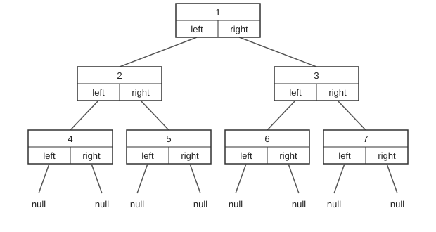

# Linked Binary Tree

Implement preorder, inorder, and postorder traversals and free a tree without leaking memory.



## Learning Outcomes

After completing this experience, learners will be able to:

1. Represent a binary tree using a linked structure
2. Implement recursive preorder traversal
3. Implement recursive inorder traversal
4. Implement recursive postorder traversal

## Usage

Once compiled, you can run your program as:

```
./tree
```

Output includes a number of tests to ensure the program works correctly followed by the results of the traversals.

## Testing

The code includes a number of embedded tests that can be run using:

```
make test
```

## Tasks

1. Implement `preorder`
2. Implement `inorder`
3. Implement `postorder`
4. Implement the deconstructor so that all nodes are freed.

## Resources

- [Binary Tree](https://en.wikipedia.org/wiki/Binary_tree)
- [recursion](https://en.wikibooks.org/wiki/C_Programming/Procedures_and_functions#Recursion)
- [OpenDSA Binary Tree Traversals](https://opendsa-server.cs.vt.edu/OpenDSA/Books/CS3/html/BinaryTreeTraversal.html) for conceptual details.
